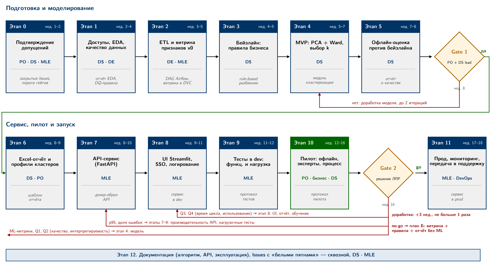
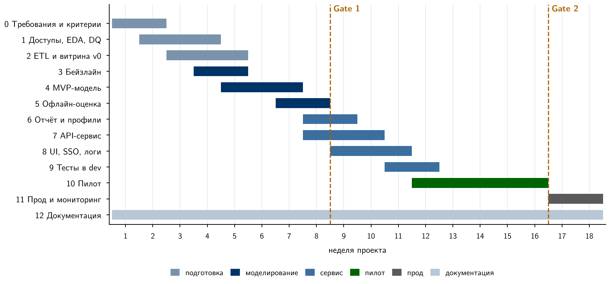
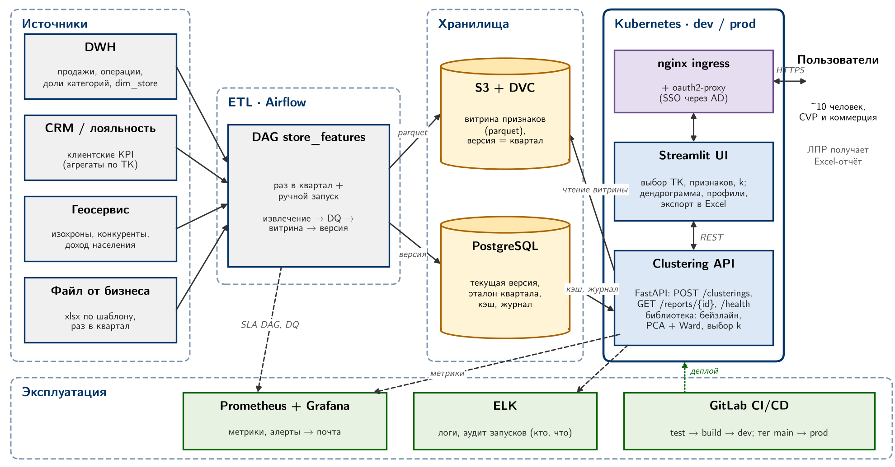
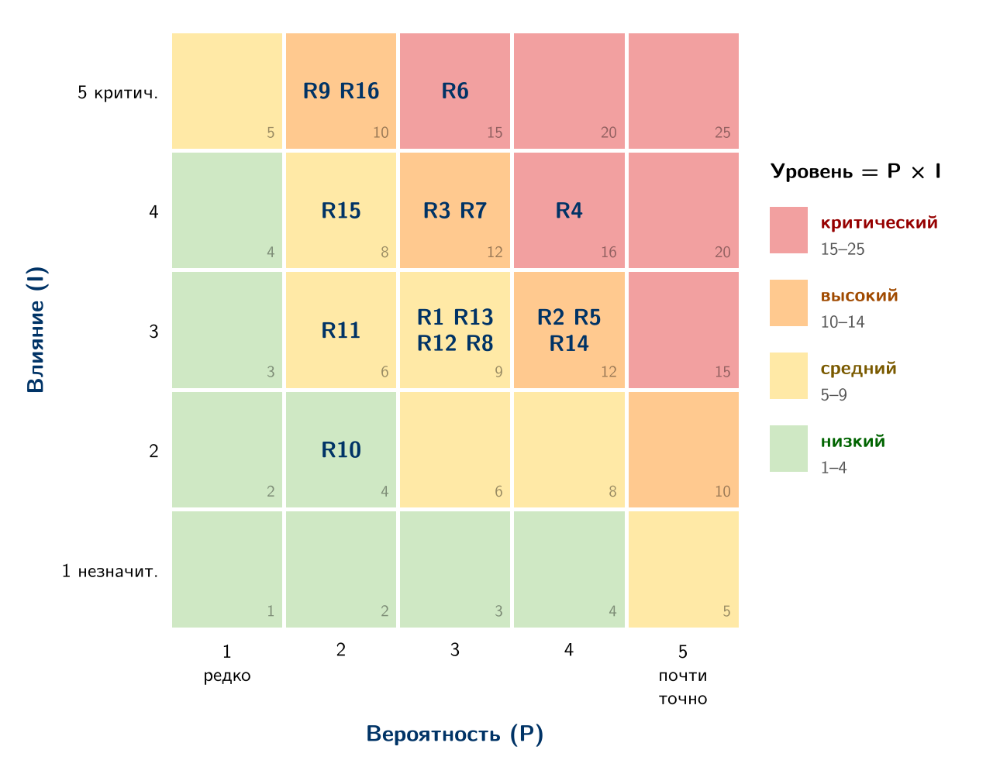
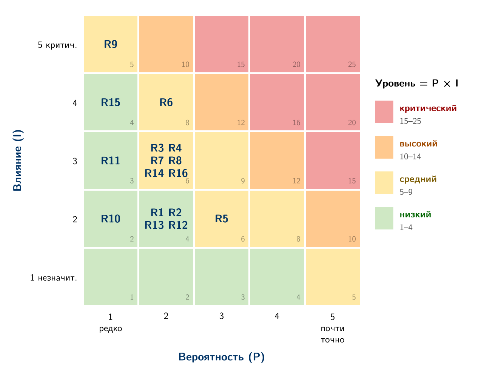
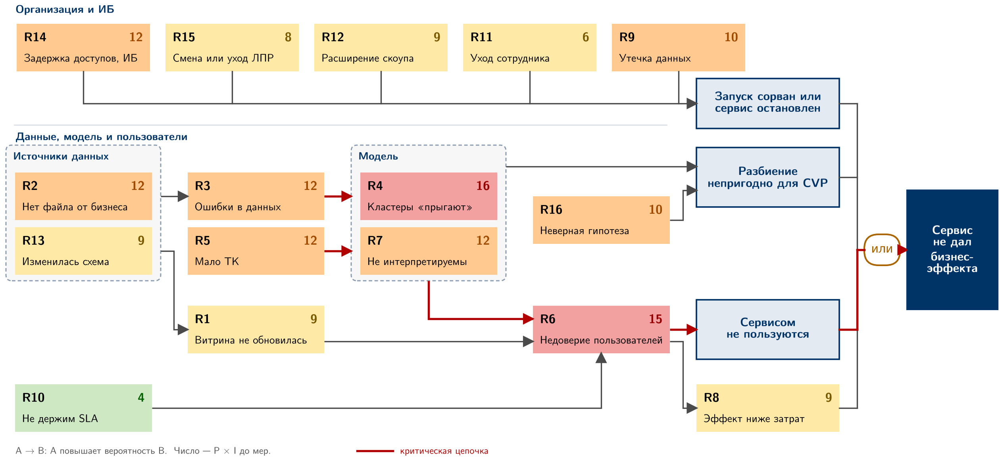

# **ML System Design Doc — сервис кластеризации гипермаркетов**
*[Шаблон ML System Design Doc](https://github.com/IrinaGoloshchapova/ml_system_design_doc_ru) от телеграм-канала [Reliable ML](https://t.me/reliable_ml)*
- Рекомендации по процессу заполнения документа (workflow) — [здесь](https://github.com/IrinaGoloshchapova/ml_system_design_doc_ru/blob/main/ML_System_Design_Doc_Workflow.md).
- Доклад о том, что такое ML System Design Doc и зачем его составлять — [тут](https://www.youtube.com/watch?v=PW9TGNr1Vqk).

| | |
|---|---|
| **Статус** | v2.4 — доработка по итогам ревью (история версий — [CHANGELOG.md](CHANGELOG.md)). Версия 2.0 согласована на встрече со стейкхолдерами; цифры, помеченные «допущение», подтверждаются на этапе 0 |
| **Старт проекта** | 16.11.2026 — понедельник недели 1. Недели плана рабочие: на новогодние праздники работа приостановлена до 11.01.2027, пауза в счёт недель не идёт. Календарь — в [§2.2](#22-блок-схема-решения) |
| **Авторы** | Nikolai Dorogin, Sergey Vasiliev, Oleg Lee |
| **Product Owner** (PO, владелец продукта) | руководитель группы коммерческой аналитики |
| **ЛПР** (лицо, принимающее решение) | директор по CVP (коммерческая дирекция) |
| **Команда** | DS (1), MLE (1), DE (0,3 FTE), PO |

> Сокращения и термины расшифрованы в [глоссарии](#7-глоссарий).
>
> Числа, которые не прозвучали на встрече, но нужны для расчётов (число ТК, ставки, сроки), отмечены в тексте как **допущение**. Полный список допущений — в [разделе 6](#6-журнал-решений-допущения-и-открытые-вопросы).
>
> 🟡 — вопрос не решён или допущение не подтверждено. У каждого такого пункта есть Issue с планом, сроком и контрагентами.
>
> История изменений документа — в [CHANGELOG.md](CHANGELOG.md), живой реестр рисков — в [risks.md](risks.md), презентация — [slides.pdf](slides.pdf).

## Оглавление

1. [Цели и предпосылки](#1-цели-и-предпосылки)
   - [1.1. Зачем идём в разработку продукта?](#11-зачем-идём-в-разработку-продукта)
   - [1.2. Бизнес-требования и ограничения](#12-бизнес-требования-и-ограничения)
   - [1.3. Что входит в скоуп проекта/итерации, что не входит](#13-что-входит-в-скоуп-проектаитерации-что-не-входит)
   - [1.4. Предпосылки решения](#14-предпосылки-решения)
   - [1.5. Команда и ответственность (RACI)](#15-команда-и-ответственность-raci)
2. [Методология](#2-методология)
   - [2.1. Постановка задачи](#21-постановка-задачи)
   - [2.2. Блок-схема решения](#22-блок-схема-решения)
   - [2.3. Этапы решения](#23-этапы-решения)
3. [Подготовка пилотирования](#3-подготовка-пилотирования)
   - [3.1. Способ оценки пилота](#31-способ-оценки-пилота)
   - [3.2. Что считаем успешным пилотом](#32-что-считаем-успешным-пилотом)
   - [3.3. Подготовка пилота](#33-подготовка-пилота)
4. [Внедрение](#4-внедрение)
   - [4.1. Архитектура решения](#41-архитектура-решения)
   - [4.2. Инфраструктура и масштабируемость](#42-инфраструктура-и-масштабируемость)
   - [4.3. Требования к работе системы](#43-требования-к-работе-системы)
   - [4.4. Мониторинг](#44-мониторинг)
   - [4.5. Безопасность системы](#45-безопасность-системы)
   - [4.6. Безопасность данных](#46-безопасность-данных)
   - [4.7. Издержки](#47-издержки)
   - [4.8. Integration points](#48-integration-points)
   - [4.9. Риски](#49-риски)
5. [Источники и исходники схем](#5-источники-и-исходники-схем)
6. [Журнал решений, допущения и открытые вопросы](#6-журнал-решений-допущения-и-открытые-вопросы)
7. [Глоссарий](#7-глоссарий)

---

## **1. Цели и предпосылки**

### **1.1. Зачем идём в разработку продукта?**

**Бизнес-цель.** Дать отделу CVP и коммерческой дирекции инструмент, который за минуты вместо нескольких часов ручной работы делит гипермаркеты сети на кластеры по коммерческим, операционным, клиентским и гео-показателям. Текущее время цикла и порог приёмки — метрика Q3 в [§1.2 «Критерии успеха»](#критерии-успеха). По этим кластерам настраивается CVP (Customer Value Proposition): ассортиментная матрица, ценовое позиционирование, промо-механики и сервисы для каждой группы магазинов.

**Почему станет лучше, чем сейчас.**
- Сейчас кластеризация ручная: аналитик запрашивает выгрузки у 2–3 команд, сводит их в Excel и делит ТК по 2–3 факторам (регион, площадь, выручка). Это занимает 3–5 часов чистого времени плюс 1–3 дня ожидания выгрузок.
- Сервис учитывает до 64 признаков, считает за секунды и воспроизводит результат: один набор параметров и одна версия данных дают одно и то же разбиение.
- Основная часть экономии времени приходится на автоматизацию сбора данных (витрина). ML добавляет качество разбиения: оно учитывает больше факторов. Поэтому прирост от ML проверяется отдельно, на сравнении с бейзлайном (этап 5, Gate 1).

**Экономика коротко.** Прямой эффект — 0,25–0,43 млн ₽ в год за счёт сэкономленных часов аналитиков; разработка — 0,45 млн ₽ разово; окупаемость — 1,3–2,8 года (§1.2 «Экономика»). Срок окупаемости — слабое место проекта, поэтому риск вложений ограничен:
- **ML-часть стоит около 60 ч DS ≈ 0,09 млн ₽** — 20 % бюджета разработки. Остальные 80 % — витрина, автоматический отчёт и сервис — дают основную экономию часов.
- **План Б сохраняет основную экономию.** Если ML не обгонит бейзлайн на Gate 1 или Gate 2, в прод уходит сервис с витриной, правилами и отчётом. Потери в худшем случае — около 0,09 млн ₽ на ML-часть.
- **Экономика — обязательный критерий пилота** (метрика Q5, порог — в [§1.2 «Критерии успеха»](#критерии-успеха)). Если она не сходится, решение принимает ЛПР (§3.2).
- Не учтены и идут в плюс: время смежных команд на выгрузки и эффект лучшего CVP на выручку (его оценка — следующая итерация).

**Что считаем успехом итерации с точки зрения бизнеса.** Пилот прошёл Gate 2 (раздел 3.2) по бизнес-метрикам ниже. Здесь — только что измеряем и как считаем; пороги и текущие значения — в [§1.2 «Критерии успеха»](#критерии-успеха).

| ID | Бизнес-метрика | Тип | Алгоритм расчёта | Данные |
|---|---|---|---|---|
| **Q1** | Качество разбиения по оценке экспертов | качественная | Слепая анкета (§3.1, часть B): эксперт видит два анонимизированных разбиения — сервиса и ручное — и отвечает «какое лучше для настройки CVP»: *сервис лучше / равноценны / ручное лучше*. Эксперт ставит «да», если ответил *сервис лучше* или *равноценны*. Q1 = число экспертов с «да». | анкеты 5 экспертов |
| **Q2** | Интерпретируемость кластеров | качественная | В той же анкете эксперт оценивает разбиение сервиса по шкале 1–5: 1 — кластеры непонятны; 3 — понятны после разбора с аналитиком; 5 — понятны по профилю без пояснений. Q2 = среднее по экспертам. | анкеты 5 экспертов |
| **Q3** | Время полного цикла кластеризации | количественная | Для каждой полной кластеризации: t = время экспорта Excel-отчёта (`GET /reports/{id}`) − время входа пользователя в сессию, в которой сделан запуск. *Полная кластеризация* — запуск на дефолтном наборе ТК (все гипермаркеты с историей от 12 мес), завершённый экспортом отчёта. Q3 = медиана t за период. AS-IS для сравнения — таймшит аналитиков. | журнал запусков в PostgreSQL, логи ELK; таймшит |
| **Q4** | Использование сервиса | количественная | *Активный пользователь недели* — участник группы `clustering_users`, у которого за календарную неделю (пн–вс) есть хотя бы 1 успешный запуск `POST /clusterings`. Q4 = число активных пользователей за неделю. | журнал запусков в PostgreSQL |
| **Q5** | Экономика: число полных кластеризаций | количественная | Q5 = число полных кластеризаций (определение — в Q3) за календарную неделю. Повторный экспорт отчёта по тому же запуску не считается. На Q5 построен расчёт прямого эффекта (§1.2 «Экономика»). | журнал запусков в PostgreSQL |

### **1.2. Бизнес-требования и ограничения**

#### Пользователи и ЛПР

| Роль | Кто | Сколько | Что делает с сервисом |
|---|---|---|---|
| Основные пользователи | аналитики и менеджеры отдела CVP | 5 | готовят квартальное разбиение, профили кластеров, исследуют варианты |
| Пользователи | категорийные менеджеры коммерческой дирекции | 3 | смотрят профиль кластера своих ТК, сравнивают кластеры по категориям |
| Пользователи | аналитики региональных дирекций | 2 | проверяют, куда попали ТК региона и почему |
| ЛПР | директор по CVP | 1 | утверждает «эталон квартала» и решение по пилоту (go / no-go) |
| Product Owner | руководитель группы коммерческой аналитики | 1 | приоритеты, приёмка, владелец критериев пилота |

**Какое решение принимается по кластерам.** Раз в квартал проходит пересмотр CVP. ЛПР утверждает разбиение («эталон квартала»), и для каждого кластера задаются: глубина и ширина ассортимента по категориям, ценовой индекс относительно конкурентов, набор промо-механик и сервисов (кулинария, доставка, пункты выдачи). Между пересмотрами пользователи запускают сервис в исследовательском режиме: проверяют гипотезы, меняют набор признаков и число кластеров.

#### Процесс AS-IS → TO-BE

| | AS-IS (сейчас) | TO-BE (с сервисом) |
|---|---|---|
| Данные | запросы выгрузок в 2–3 команды, ожидание 1–3 дня | витрина обновляется раз в квартал автоматически (Airflow) |
| Сведение | ручная сборка в Excel | готовая витрина признаков, версия = квартал |
| Разбиение | правила по 2–3 факторам: регион, площадь, выручка | бейзлайн-правила (формализация AS-IS, этап 3) и ML (PCA + Ward), выбор k вручную или автоматически |
| Проверка | визуально, на усмотрение аналитика | метрики качества, профили, сравнение с прошлым кварталом |
| Отчёт | собирается вручную | Excel-отчёт формируется автоматически |
| Время | 3–5 ч чистого времени | около 15 мин; порог приёмки — 20 мин с запасом на освоение |
| Воспроизводимость | нет | параметры и версия данных сохраняются в журнале |

#### Нагрузка

По итогам встречи сервисом будут пользоваться **10 человек несколько раз в сутки**: 30–50 запусков в день, до 5 одновременных сессий в пике. Большая часть запусков — исследовательские (смена признаков, k, набора ТК). Полных кластеризаций, которые заменяют ручную работу, около 3 в неделю. На них построен расчёт экономики.

#### Требования

**Функциональные:**
- выбор набора ТК (по умолчанию все гипермаркеты с историей от 12 месяцев), групп признаков и отдельных признаков;
- обязательный дефолтный набор из 12 KPI: они всегда выводятся в отчёте;
- число кластеров задаётся вручную (3–8) или подбирается автоматически;
- результат: метки ТК, профили кластеров, дендрограмма, метрики качества, миграции ТК относительно эталона прошлого квартала;
- выгрузка в Excel и сохранение параметров запуска для воспроизведения;
- режим «бейзлайн» (правила) рядом с ML-разбиением.

**Нефункциональные (SLA):**

| Параметр | Требование |
|---|---|
| Время расчёта и отчёта, p95 | ≤ 30 с для ≤ 150 ТК |
| Одновременные сессии | до 10 без деградации |
| Доступность | 99 % в рабочие часы (пн–пт, 9:00–19:00 МСК) |
| Доля ошибок запуска | ≤ 1 % |
| Свежесть данных | витрина не старше 100 дней (квартал + 10 дней на ETL) |
| Доступ | только через SSO, группа AD `clustering_users` |

**Бизнес-ограничения:**
- объекты: только ТК формата «Гипермаркет»; другие форматы в эту итерацию не входят;
- данные обновляются раз в квартал, расчёт выполняется по запросу на последней версии витрины;
- разбиение должно быть интерпретируемым: каждый кластер описывается через исходные KPI, а не через главные компоненты;
- эталон квартала не меняется без решения ЛПР.

#### Экономика

Цифры подтверждены на встрече стейкхолдеров.

| Статья | Расчёт | Значение |
|---|---|---|
| Экономия на одну кластеризацию | (3…5 ч) − 0,25 ч | 2,75–4,75 ч |
| Полных кластеризаций в год | 3 в неделю ≈ 12 в месяц × 12 | 144 |
| Экономия часов в год | 144 × (2,75…4,75) | 396–684 ч |
| Ставка бизнес-пользователя | 1 млн ₽ / 12 мес / 132 ч (см. пояснение под таблицей) | ≈ 630 ₽/ч |
| В неделю / в рабочий день | 3 × (2,75…4,75 ч) = 8,3–14,3 ч; ÷ 5 дней | 1,7–2,9 ч в день ≈ 1 000–1 800 ₽ |
| **Прямой эффект** | 396…684 ч × 630 ₽ | **0,25–0,43 млн ₽ в год** |
| Разработка, разово (допущение) | DS 110 + MLE 130 + DE 40 + PO 20 = 300 ч × 1 500 ₽ | 0,45 млн ₽ |
| Эксплуатация в год (допущение) | доля k8s 3 тыс. ₽/мес + поддержка 3 ч/мес × 1 500 ₽ | 0,09 млн ₽ |
| **Чистый эффект в год** | 0,25…0,43 − 0,09 | **0,16–0,34 млн ₽** |
| **Окупаемость** | 0,45 / (0,16…0,34) | **1,3–2,8 года** |

- **Ставка 630 ₽/ч.** 1 млн ₽ — годовой ФОТ одного аналитика отдела CVP с налогами и страховыми взносами (из исходного расчёта ФОТ). 132 ч — рабочие часы аналитика в месяц: 80 % месячной нормы (около 165 ч при 40-часовой неделе). Остальные 20 % — встречи, отпуск и больничные, то есть время, которое не идёт на задачи. Поэтому 630 ₽ — стоимость часа, реально доступного для работы: 1 000 000 / 12 / 132 ≈ 631 ₽.
- Исследовательские запуски (10 человек несколько раз в сутки) в экономию не включены: без сервиса их бы не делали. Это консервативная оценка.
- Не включены: время смежных команд на выгрузки и эффект от лучшего CVP на выручку. Эффект CVP оценивается в следующей итерации (раздел 1.3).
- ML-часть (бейзлайн против PCA + Ward) стоит около 60 ч DS ≈ 0,09 млн ₽. Если на Gate 1 или Gate 2 ML не лучше бейзлайна, в прод уходит сервис с витриной и правилами (план Б): основная экономия часов сохраняется.

#### Критерии успеха

Требования к бизнес-метрикам из §1.1. Алгоритмы расчёта — там же; правило «выкатываем / не выкатываем» — в §3.2.

| Метрика | Текущее значение (AS-IS) | Порог успешного пилота | Обязательный |
|---|---|---|---|
| Q1. Качество по оценке экспертов | ручное разбиение — точка сравнения | «да» у ≥ 4 из 5 экспертов | да |
| Q2. Интерпретируемость | не измерялась | среднее ≥ 4 из 5 | да |
| Q3. Время полного цикла | 3–5 ч чистого времени + 1–3 дня ожидания выгрузок | медиана ≤ 20 мин | да |
| Q4. Использование | сервиса нет | ≥ 7 из 10 активных в среднем за недели 13–16 | да |
| Q5. Полных кластеризаций в неделю | около 3 в неделю вручную | ≥ 3 в среднем за недели 13–16 | да |

ML-метрики и метрики сервиса:
- **ML:** Silhouette ≥ 0,20 и выше бейзлайна минимум на 0,05, DBI ниже бейзлайна, устойчивость ARI ≥ 0,75;
- **сервис:** p95 ≤ 30 с, ошибок ≤ 1 %.

**Почему пороги такие.**

| Порог | Обоснование |
|---|---|
| Q1: «да» у ≥ 4 из 5 экспертов | Простое большинство — 3 из 5. Требуем 4 из 5, потому что сервис заменяет ручную работу самих экспертов: при 3 из 5 двое будущих пользователей считали бы ручное разбиение лучше. |
| Q2: среднее ≥ 4 из 5 | Оценка 4 по шкале Q2 — кластеры понятны по профилю с небольшими пояснениями. Ниже 4 кластеры требуют разбора с аналитиком, и ЛПР не утвердит эталон по отчёту. |
| Q3: медиана ≤ 20 мин | Типичный цикл — около 15 мин: расчёт занимает секунды, остальное — просмотр профилей и экспорт. 5 мин — запас на освоение в первые недели пилота. Даже 20 мин — это экономия не меньше 89 % от 3 ч. |
| Q4: ≥ 7 из 10 активных | Разбиение готовят 5 аналитиков CVP. 7 из 10 — это они и хотя бы 2 из 5 категорийных и региональных пользователей. Меньше 5 активных — индикатор риска R6. |
| Q5: ≥ 3 полных кластеризаций в неделю | Экономика сходится: при 3 в неделю окупаемость 1,3–2,8 года (§1.2 «Экономика»), при 2 в неделю в пессимистичном сценарии — около 6 лет. Это бывший индикатор риска R8, перенесённый в критерии приёмки. |
| Silhouette ≥ 0,20 | По шкале Kaufman & Rousseeuw [[22]](#l22) значения до 0,25 означают, что выраженной структуры нет, 0,26–0,50 — слабая структура. Для магазинов одного формата сильной структуры не ожидаем: цель — удобное для CVP деление, а не «естественные» группы. Поэтому 0,20 — нижняя граница «разбиение не случайно», а главные требования — превосходство над бейзлайном и устойчивость. 🟡 [#20](https://github.com/MajorN13/ml_system_design_doc_clustering/issues/20) Если EDA покажет, что типичные значения выше 0,25, порог поднимается до 0,25 на Gate 1. |
| Silhouette ≥ бейзлайн + 0,05 | Минимальная разница, которую считаем существенной. Она должна быть больше разброса Silhouette ML-разбиения на тех же 100 подвыборках, что и для ARI. Если стандартное отклонение больше 0,05, сравниваем по нижней границе 95 %-го интервала разницы. |
| DBI < DBI бейзлайна | У DBI нет общепринятой абсолютной шкалы, поэтому только относительное сравнение. |
| ARI ≥ 0,75 | Ориентир Hennig [[6]](#l6): кластер устойчив, если среднее сходство на повторных подвыборках не ниже 0,75 (у Hennig — по Jaccard; для ARI берём тот же уровень). |
| Межквартальная стабильность ≤ 15 % | Около 13 ТК из 86 за квартал — объём, для которого отдел CVP успевает сменить CVP за один квартальный цикл. 🟡 [#19](https://github.com/MajorN13/ml_system_design_doc_clustering/issues/19) Порог предложен командой, подтверждается с PO на этапе 0. |
| Минимальный кластер ≥ 5 ТК | Каждому кластеру задаётся свой CVP. При меньшем числе ТК медианы профиля неустойчивы, а CVP фактически становится индивидуальным для магазина. |
| Внешняя валидация: 2 из 3 отложенных KPI | Большинство отложенных KPI. Поправка Холма [[20]](#l20) удерживает общую ошибку на уровне 5 % при трёх сравнениях. |
| p95 ≤ 30 с | Предел, при котором исследовательский режим остаётся интерактивным. Сам расчёт занимает меньше 2 с (§3.3), остальное — отчёт и сеть. |
| Ошибок ≤ 1 % | При 30–50 запусках в день — не больше одного сбойного запуска в день. |
| Ручные переносы ≤ 10 % | Около 9 ТК из 86. Больше — значит, пользователи фактически пересобирают разбиение вручную (индикатор риска R6). 🟡 [#19](https://github.com/MajorN13/ml_system_design_doc_clustering/issues/19) Порог предложен командой, подтверждается с PO на этапе 0. |

**Что не должно стать хуже, чем сейчас:**
- качество разбиения относительно ручного по оценке экспертов (Q1: ответ «равноценны» допускается, «ручное лучше» у большинства — нет);
- межквартальная стабильность относительно ручного разбиения: в части A пилота доля ТК, сменивших кластер, у ML-разбиения не выше, чем у ручного за те же кварталы;
- время цикла относительно AS-IS (Q3);
- доступ к результату: при сбое сервиса пользователи работают с Excel-отчётом эталона квартала (RTO 4 ч, §4.3).

#### Возможные пути развития
- кластеризация других форматов (супермаркеты, магазины у дома) с отдельными наборами признаков;
- оценка влияния CVP по кластерам на выручку (difference-in-differences через 2 квартала после изменений);
- полноценный фронтенд вместо Streamlit, если число пользователей вырастет больше 30;
- consensus clustering и HDBSCAN для более устойчивых разбиений.

### **1.3. Что входит в скоуп проекта/итерации, что не входит**

**Входит в итерацию (MVP):**
- витрина признаков и DAG в Airflow с проверками качества данных;
- бейзлайн (правила текущей ручной кластеризации) и MVP-алгоритм (PCA + Agglomerative Ward);
- API-сервис, UI на Streamlit, SSO, логирование, мониторинг;
- Excel-отчёт по шаблону PO;
- пилот с двумя гейтами и вывод в прод.

**Не входит:**
- форматы ТК кроме «Гипермаркета»;
- оценка эффекта CVP на продажи;
- обновление данных чаще раза в квартал;
- отдельный фронтенд.

**Качество кода и воспроизводимость:** отдельный репозиторий; модули `data` (загрузка и проверки), `features`, `clustering` (бейзлайн, MVP, метрики), `report`, `api`, `ui`. Тесты на модули и API, линтеры в CI. Каждый запуск сохраняет версию витрины, параметры и хэш кода.

**Технический долг:**
- Streamlit как UI: подходит для 10 пользователей, но не для широкого внедрения;
- веса групп признаков задаются вручную, без оптимизации;
- нет автоматического сопоставления новых ТК между кварталами (новые ТК присваиваются ближайшему кластеру по центроиду).

### **1.4. Предпосылки решения**

- Объектов мало (≈ 86 ТК), признаков много (до 64), меток нет: задача обучения без учителя на маленькой выборке. Отсюда выбор иерархической кластеризации, понижение размерности и строгие проверки устойчивости.
- Данные агрегированы по ТК за 12 месяцев: суточной динамики и онлайн-обновления не требуется.
- Бизнесу важнее интерпретируемость и стабильность, чем максимум метрики: ТК, которые прыгают между кластерами, ломают CVP-решения.
- Пользователей мало, расчёт лёгкий: тяжёлая инфраструктура не нужна.

### **1.5. Команда и ответственность (RACI)**

**R** — исполняет, **A** — отвечает за результат и принимает работу (один на строку), **C** — консультирует, **I** — информируется.

| Этап / работа | ЛПР | PO | DS | MLE | DE | DevOps | ИБ | Data Office | Пользователи, эксперты |
|---|---|---|---|---|---|---|---|---|---|
| 0. Требования и критерии гейтов | C | **A** | R | R | C | — | C | — | C |
| 1. Доступы, EDA, DQ-правила | — | I | **A**, R | — | R | — | C | C | — |
| 2. ETL и витрина признаков | — | I | C | C | **A**, R | C | — | C | — |
| 3–5. Бейзлайн, модель, офлайн-оценка | — | I | **A**, R | C | C | — | — | — | — |
| Gate 1 | I | **A** | R | C | — | — | — | — | — |
| 6. Excel-отчёт и профили | — | **A** | R | C | — | — | — | — | C |
| 7–9. API, UI, тесты | — | I | C | **A**, R | C | C | C | — | — |
| 10. Пилот | I | **A** | R | R | — | — | — | — | R |
| Gate 2 (решение по пилоту) | **A** | R | C | C | — | — | — | — | C |
| 11. Вывод в прод | I | I | C | **A**, R | C | R | C | — | — |
| 12. Документация | — | C | R | **A**, R | C | — | — | — | — |
| Утверждение эталона квартала | **A** | R | C | — | — | — | — | — | C |
| Эксплуатация и мониторинг | — | I | R | **A** | R | R | — | — | — |
| Реестр рисков | I | **A**, R | R | R | R | — | C | — | — |

---

## **2. Методология**

### **2.1. Постановка задачи**

| | |
|---|---|
| **Тип задачи** | обучение без учителя: иерархическая кластеризация |
| **Объект** | гипермаркет (ТК), активный, с историей от 12 месяцев: ≈ 86 из 92 (допущение) |
| **Признаки** | до 64 числовых агрегатов за скользящие 12 месяцев, 6 групп (этап 1) |
| **Выход** | метка кластера для каждого ТК, профиль кластера по 12 дефолтным KPI, топ-5 отличающих признаков, дендрограмма, миграции к эталону прошлого квартала |
| **Число кластеров** | k ∈ [3; 8]: вручную или автоматически |
| **Ограничения** | детерминированность, минимум 5 ТК в кластере, интерпретация через исходные KPI |
| **Бейзлайн** | правила текущей ручной кластеризации (этап 3) |

### **2.2. Блок-схема решения**

Ниже тот же план в виде графика по неделям. Полный цикл занимает 18 рабочих недель, из них пилот — 5 (недели 12–16).

**Календарь.** Неделя 1 начинается 16.11.2026. На новогодние праздники работа приостановлена: неделя 7 (28.12–31.12.2026) неполная, неделя 8 начинается 11.01.2027. Пауза в счёт недель не идёт, поэтому номера недель в документе — рабочие недели. Однодневные праздники 23.02 и 08.03 работу не останавливают: они приходятся на недели 14 и 16 и укладываются в запас.

| Веха | Неделя | Даты |
|---|---|---|
| Этап 0: требования, подтверждение допущений | 1–2 | 16.11–27.11.2026 |
| Новогодняя пауза | — | до 10.01.2027 включительно |
| Gate 1 | конец 8 | 15.01.2027 |
| Готовность к тестам в dev: решение по общему PostgreSQL ([#34](https://github.com/MajorN13/ml_system_design_doc_clustering/issues/34)) | конец 10 | 29.01.2027 |
| Пилот | 12–16 | 08.02–12.03.2027 |
| Gate 2 | конец 16 | 12.03.2027 |
| Финальное согласование с ИБ ([#41](https://github.com/MajorN13/ml_system_design_doc_clustering/issues/41)) | 17 | до 19.03.2027 |
| Вывод в прод, базовый сценарий | 17–18 | 15.03–26.03.2027 |
| Срок для бизнеса с учётом запаса | 21 | не позже 16.04.2027 |

Даты вех в Issues (milestones) совпадают с этой таблицей.

**Запас на доработку.** График показывает базовый сценарий — 18 недель. Срок для бизнеса — вывод в прод не позже недели 21 (16.04.2027): 18 недель плюс 3 недели запаса. Запас покрывает одну доработку после Gate 2 (повторный Gate 2 — конец недели 19, прод — недели 20–21) или одну дополнительную итерацию этапа 4 после Gate 1. Если понадобятся обе, PO сообщает ЛПР о сдвиге сроков по регламенту эскалации (§4.9).

### **2.3. Этапы решения**

#### **Этап 0. Требования и критерии успеха** (нед. 1–2; PO, DS, MLE)
- Интервью с пользователями и ЛПР: решения по кластерам, формат отчёта, дефолтный набор KPI.
- Формализация бейзлайна: правила, по которым сейчас делят вручную.
- Фиксация порогов пилота и состава пилотного комитета (раздел 3).
- **Выход:** согласованные требования, критерии Gate 1 и Gate 2, шаблон Excel-отчёта.

#### **Этап 1. Доступы, EDA, качество данных** (нед. 2–4; DS, DE)

| Группа признаков | Источник | Таблица / файл | Признаков | Примеры | Обновление | Владелец, доступ |
|---|---|---|---|---|---|---|
| Коммерческие | DWH | `dm_sales.store_month` | 15 | выручка на м², трафик (чеков в день), средний чек, маржа %, доля промо, доля СТМ | ежедневно, агрегат за 12 мес | Data Office; сервисная учётка read-only через IDM |
| Аналитические | файл от бизнеса | `analytics_quarter.xlsx` → S3 | 8 | индекс конкурентного давления, экспертная оценка локации, статус реконструкции | раз в квартал, до 10-го числа 1-го месяца квартала | отдел коммерческой аналитики, ответственный аналитик |
| Операционные | DWH | `dm_ops.store_month` | 10 | торговая площадь, число касс, ФОТ на м², потери %, OOS %, часы работы | ежедневно | Data Office |
| Клиентские KPI | CRM / лояльность | `dm_crm.store_kpi` | 9 | доля чеков по картам, частота визитов, отток, NPS | ежемесячно | CRM-команда; только агрегаты по ТК |
| Клиентские предпочтения | DWH | `dm_sales.store_category_share` | 14 | доли категорий в выручке: fresh, алкоголь, non-food и др. | ежедневно | Data Office |
| Геоданные | геосервис | `geo.store_features` | 8 | население в 15-минутной изохроне, доход населения, конкуренты в радиусе 3 км, тип локации | раз в полгода | гео-команда |
| Справочник ТК | DWH | `dim_store` | — | формат, регион, дата открытия, статус | ежедневно | Data Office |
| **Итого** | | | **64** | дефолтный набор: 12 KPI | | |
| Отложенные KPI (только для валидации) | DWH | `dm_sales.store_month`, `dm_promo.uplift` | 3 | LFL-динамика выручки г/г, средний промо-аплифт, доля продаж новинок ассортимента | ежедневно | Data Office |

**Отложенные KPI** в кластеризацию не входят и в UI как признаки недоступны. Они нужны только для внешней проверки: различаются ли кластеры по результатам, которые модель не видела (этап 5).

**Особенности признаков:**
- **Доли категорий (14 шт., включая «прочее») в сумме дают 100 %.** Это композиционные данные: признаки линейно зависимы, а рост одной доли автоматически снижает остальные. Поэтому перед стандартизацией к ним применяется CLR-преобразование (centered log-ratio): clr(x)ⱼ = ln(xⱼ / g(x)), где g(x) — среднее геометрическое долей ТК. Нулевые доли заранее заменяются на 0,5 × минимальную ненулевую долю категории, остальные доли нормируются обратно к 100 %. DQ-правило: сумма долей 100 % ± 0,5 %.
- **Дубли.** Часть признаков почти линейно выражается через другие (например, выручка ≈ трафик × средний чек). Внутри группы из пары с |r| > 0,95 остаётся один признак: тот, что входит в дефолтный набор или понятнее бизнесу. Список исключений фиксируется в отчёте EDA.

- **Период:** скользящие 12 месяцев, заканчивающиеся последним закрытым кварталом. История за 3 года нужна для проверки устойчивости разбиений.
- **Ожидаемые проблемы качества:** NPS собирается не во всех ТК (до 20 % пропусков), доход населения в геосервисе есть не для всех городов, ТК после реконструкции имеют разрыв в рядах.
- **DQ-правила (Great Expectations):** число ТК отличается от прошлого квартала не больше чем на 5 %; пропуски по признаку ≤ 20 % (больше 30 % — признак исключается из запуска); значения в допустимых диапазонах; схема источника совпадает с контрактом.
- **Выход:** отчёт EDA, набор DQ-правил, подтверждённые доступы.

#### **Этап 2. ETL и витрина признаков v0** (нед. 3–5; DE, MLE)
- DAG `store_features` в Airflow: извлечение → DQ-проверки → сборка витрины → публикация версии в S3/DVC и запись `current_version` в PostgreSQL.
- Плановый запуск: раз в квартал после загрузки файла от бизнеса; также доступен ручной запуск.
- ETL делается до моделирования, чтобы модель с первого дня строилась на тех же данных, что и в проде.
- **Выход:** витрина v0 в DVC, DAG в dev.

#### **Этап 3. Бейзлайн** (нед. 4–5; DS)
- Формализуем текущую ручную кластеризацию: макрорегион (4 группы) × тир выручки на м² (выше/ниже медианы) → до 8 групп; группы меньше 5 ТК объединяются с ближайшей по выручке.
- **Почему площадь не отдельный фактор.** В AS-IS ТК делят по региону, площади и выручке. Если взять все три фактора напрямую (4 макрорегиона × 2 класса площади × 2 тира выручки), получается до 16 групп, в среднем около 5 ТК в группе, и многие группы меньше минимума в 5 ТК. Поэтому площадь и выручка объединены в один показатель — выручку на м²: площадь входит в него знаменателем, а сам показатель отражает эффективность использования площади, по которой аналитики и различают ТК. Площадь как таковая остаётся в профилях кластеров.
- 🟡 [#18](https://github.com/MajorN13/ml_system_design_doc_clustering/issues/18) Формализация бейзлайна подтверждается с аналитиками CVP на этапе 0. Если они считают площадь самостоятельным фактором, бейзлайн меняется на «макрорегион × класс площади» (до 8 групп), а выручка на м² переходит в профили.
- Для сравнения на пилоте берётся также фактическое ручное разбиение последнего квартала.
- **Выход:** rule-based разбиение, встроенное в сервис как отдельный режим.

#### **Этап 4. MVP-алгоритм** (нед. 5–7; DS)

**Пайплайн:**
1. Фильтр: формат «Гипермаркет», история от 12 месяцев. Новые ТК присваиваются ближайшему кластеру по центроиду в пространстве главных компонент после расчёта.
2. Признаки с пропусками больше 30 % исключаются, остальные пропуски заполняются медианой.
3. Доли категорий → CLR-преобразование (этап 1).
4. Выбросы ограничиваются по 1-му и 99-му перцентилям (винзоризация).
5. Стандартизация (StandardScaler).
6. Удаление дублей: из пар с |r| > 0,95 внутри группы остаётся один признак (этап 1).
7. **Взвешивание групп по схеме MFA (Multiple Factor Analysis).** Для каждой группы g считается PCA её стандартизированных признаков, и все признаки группы делятся на √λ₁(g), где λ₁(g) — первое собственное значение корреляционной матрицы группы. После этого главная ось каждой группы имеет дисперсию 1. Ни одна группа не перевешивает остальные ни числом признаков (14 долей категорий против 8 гео), ни сильной корреляцией внутри себя. Пользовательский вес группы w_g (по умолчанию 1, задаётся в UI) умножает её признаки на √w_g.
8. **Глобальный PCA** на взвешенных данных. Берётся минимальное число компонент, которое объясняет не меньше 80 % дисперсии, но не больше min(10, N/8). Критерий Кайзера (λ ≥ 1) здесь не используется: он предполагает, что дисперсия каждого признака равна 1, а после взвешивания это не так.
9. AgglomerativeClustering, linkage = `ward`.
10. Выбор k: вручную или автоматически — максимум Silhouette на k ∈ [3; 8] при условии, что минимальный кластер содержит от 5 ТК. Silhouette для выбора k считается в том же пространстве, что и на Gate 1, — на стандартизированных 12 дефолтных KPI, а не в пространстве главных компонент. Так автоматический выбор k и приёмка опираются на один критерий.
11. Стабилизация меток: кластеры сопоставляются с эталоном прошлого квартала венгерским алгоритмом по пересечению состава, чтобы «кластер 2» оставался «кластером 2».
12. Профили: медианы 12 дефолтных KPI и топ-5 признаков, которыми кластер отличается от остальных (по |z|). Это описание кластера, а не метрика качества.

**Почему Ward:** детерминирован, хорошо работает на малых выборках, даёт дендрограмму, которую бизнес умеет читать.
**Альтернативы на этом этапе:** k-means (неустойчив на 86 объектах), GMM и HDBSCAN (на такой выборке много шума и мелких кластеров). Их сравниваем по тем же метрикам, но в MVP не берём.

**Обоснование выбора (литература и опыт отрасли):**
- **Мировой опыт.** Кластеризация магазинов сети по продажам, площади, демографии зоны охвата и конкурентам — стандартный приём для настройки ассортимента, маркетинга и сетевого планирования [[1]](#l1), [[2]](#l2), [[3]](#l3). Иерархическая кластеризация в этих работах служит опорным методом, с которым сравнивают остальные [[1]](#l1).
- **Ward.** Метод минимизирует прирост внутрикластерной суммы квадратов на каждом шаге объединения [[4]](#l4); корректная реализация критерия разобрана в [[5]](#l5). Метод детерминирован: при одних данных и параметрах разбиение одно и то же, что нужно для воспроизводимости эталона квартала.
- **Почему не k-means.** Результат зависит от случайной инициализации, а устойчивость разбиения на малой выборке нужно доказывать отдельно [[6]](#l6), [[7]](#l7). На 86 ТК это лишний источник «прыгающих» кластеров (риск R4).
- **Почему не HDBSCAN в MVP.** Метод помечает часть объектов как шум [[8]](#l8), а у нас каждый ТК обязан получить кластер и CVP.
- **CLR для долей категорий.** Доли, дающие в сумме 100 %, — композиционные данные; для них применяют лог-отношения [[9]](#l9), нули заменяют малым значением до преобразования [[10]](#l10).
- **Взвешивание групп (MFA).** Деление признаков группы на √λ₁ — схема Multiple Factor Analysis [[11]](#l11), [[12]](#l12): ни одна группа признаков не доминирует.
- **Число компонент PCA.** Правило накопленной дисперсии и отказ от критерия Кайзера — по обзорам правил остановки [[13]](#l13), [[14]](#l14).
- **Метрики.** Silhouette [[15]](#l15), Davies–Bouldin [[16]](#l16), ARI [[17]](#l17); оценка устойчивости через повторные подвыборки — по [[6]](#l6), [[7]](#l7); там же приведены ориентиры: устойчивый кластер — среднее сходство ≥ 0,75 (у Hennig — по Jaccard). Стабилизация меток — венгерский алгоритм [[18]](#l18). Внешняя валидация — тест Краскела–Уоллиса [[19]](#l19) с поправкой Холма [[20]](#l20) и размером эффекта ε² [[21]](#l21).

Полный список — в [разделе 5](#5-источники-и-исходники-схем).

#### **Этап 5. Офлайн-оценка против бейзлайна** (нед. 7–8; DS) → **Gate 1**

Все метрики считаются в одном пространстве признаков: стандартизированный дефолтный набор из 12 KPI. Это нужно, чтобы бейзлайн и ML сравнивались честно.

| Метрика | Что показывает | Порог для Gate 1 |
|---|---|---|
| Silhouette | насколько ТК ближе к своему кластеру, чем к соседнему | ≥ 0,20 и ≥ бейзлайн + 0,05 |
| Davies–Bouldin (DBI) | отношение разброса внутри к расстоянию между кластерами | < DBI бейзлайна |
| Устойчивость: средний ARI на 100 бутстрэп-подвыборках по 90 % ТК | не разваливается ли разбиение при небольшом изменении данных | ≥ 0,75 |
| Межквартальная стабильность (история за 3 года) | доля ТК, сменивших кластер между соседними кварталами при тех же признаках | ≤ 15 % |
| Размер кластера | нет ли кластеров из 1–2 ТК | минимум ≥ 5 ТК |
| Внешняя валидация на отложенных KPI | различаются ли кластеры по результатам, которых модель не видела | см. ниже |

**Связь ML-метрик с бизнес-метриками §1.1.**

| ML-метрика | Какую бизнес-метрику поддерживает | Почему |
|---|---|---|
| Silhouette, DBI | Q1 (качество по экспертам), Q2 (интерпретируемость) | Компактные и хорошо разделённые кластеры легче описать профилем и отличить друг от друга. |
| Устойчивость ARI, межквартальная стабильность | Q4 (использование), доля ручных переносов | ТК, которые «прыгают» между кластерами, подрывают доверие: пользователи начинают править разбиение вручную или перестают пользоваться сервисом (риски R4 → R6). |
| Минимальный размер кластера | Q1, Q2 | Кластеру из 1–2 ТК нельзя задать отдельный CVP, такое разбиение эксперты не примут. |
| Внешняя валидация на отложенных KPI | Q1 (вопрос о применимости для CVP), будущий эффект CVP | Если кластеры различаются по результатам, которых модель не видела, по ним имеет смысл настраивать CVP (риск R16). |
| p95 расчёта, доля ошибок | Q3 (время цикла), Q4 | Медленный или сбойный сервис увеличивает время цикла и снижает использование. |

**Внешняя валидация.** Проверять различимость по признакам, на которых строилась кластеризация, нельзя: кластеры, построенные по признаку, почти всегда по нему различаются, и тест получается круговым. Поэтому различимость проверяется только на 3 отложенных KPI (этап 1): LFL-динамика выручки г/г, средний промо-аплифт, доля продаж новинок.
- Для каждого отложенного KPI — тест Краскела–Уоллиса между кластерами с поправкой Холма на 3 сравнения и размер эффекта ε² = H / (N − 1).
- **Порог Gate 1:** значимые различия (p < 0,05 после поправки) минимум по 2 из 3 отложенных KPI, и средний ε² ML-разбиения не меньше, чем у бейзлайна. Бейзлайн проверяется на тех же KPI, поэтому сравнение честное для обоих.
- Различия по 12 дефолтным KPI показываются в профилях, но в критерии качества не входят.

**Gate 1:** PO и DS lead. Все пороги выполнены → этап 6. Нет → возврат к этапу 4 (не больше 2 итераций). После двух неудач в сервис идёт бейзлайн, и это фиксируется в журнале решений.

#### **Этап 6. Excel-отчёт и профили кластеров** (нед. 8–9; DS, PO)
Листы отчёта: «ТК → кластер», профили кластеров, миграции к эталону прошлого квартала, метрики качества, параметры запуска (версия данных, признаки, k, хэш кода).

#### **Этап 7. API-сервис** (нед. 8–10; MLE)
FastAPI: `POST /clusterings` (параметры → id запуска и результат), `GET /reports/{id}` (Excel), `GET /versions`, `GET /health`. Результаты кэшируются по хэшу (версия витрины, набор ТК, признаки, веса, k). **Выход:** докер-образ API.

#### **Этап 8. UI, SSO, логирование** (нед. 9–11; MLE)
Streamlit-приложение работает поверх API. Вход через oauth2-proxy (SSO, AD). Структурные логи уходят в ELK, метрики — в Prometheus. **Выход:** сервис в dev-контуре.

#### **Этап 9. Тестирование в dev** (нед. 11–12; MLE)
- Функциональные тесты: сценарии пользователей, совпадение результатов при повторном запуске.
- Нагрузочные тесты: 10 одновременных сессий, 50 запусков в час, проверка p95 ≤ 30 с.
- Проверка ИБ: доступ без SSO закрыт, секреты не хранятся в образе.

#### **Этап 10. Пилот** (нед. 12–16; PO, бизнес, DS) → **Gate 2**
Описан в разделе 3.

#### **Этап 11. Прод, мониторинг, передача в поддержку** (нед. 17–18; MLE, DevOps)
Деплой по тегу из `main`, дашборды и алерты (раздел 4.4), инструкция по эксплуатации, передача DevOps.

#### **Этап 12. Документация** (сквозной; DS, MLE)
Описание алгоритма и метрик, методы API, инструкция пользователя, runbook. Неясные места фиксируются в Issues репозитория с меткой `white-spot`.

---

## **3. Подготовка пилотирования**

### **3.1. Способ оценки пилота**

A/B-тест в классическом виде здесь невозможен: разбиение одно на всю сеть, а эффект CVP проявляется через кварталы. Поэтому пилот состоит из трёх частей.

| Часть | Когда | Кто | Что делаем |
|---|---|---|---|
| **A. Офлайн-ретро** | нед. 12 | DS | прогоняем сервис на 4 последних кварталах, сравниваем ML, бейзлайн и фактическое ручное разбиение по метрикам этапа 5 и межквартальной стабильности |
| **B. Слепая экспертная оценка** | нед. 13 | 5 экспертов отдела CVP | эксперты получают два анонимизированных разбиения текущего квартала (ручное и ML, порядок случайный) с профилями и оценивают каждое по анкете: интерпретируемость (1–5), применимость для CVP (1–5), какое разбиение лучше |
| **C. Процессный пилот** | нед. 13–16 | 10 пользователей | реальный квартальный цикл CVP в сервисе; время замеряем по логам (от входа до экспорта отчёта) и по короткому таймшиту, собираем обратную связь |

### **3.2. Что считаем успешным пилотом**

Правило применяется ко всем бизнес-метрикам из §1.1 с порогами из §1.2, а также к ML-метрикам и метрикам сервиса. Как считаются метрики — §1.1 и этап 5; здесь не повторяется.

| Критерий | Метрика | Порог | Обязательный |
|---|---|---|---|
| Качество разбиения по метрикам на свежем квартале | ML-метрики этапа 5 | все пороги Gate 1 | да |
| Экспертная оценка «не хуже ручного» | Q1 | ≥ 4 из 5 экспертов | да |
| Интерпретируемость | Q2 | среднее ≥ 4 из 5 | да |
| Время полного цикла | Q3 | медиана ≤ 20 мин | да |
| Использование | Q4 | ≥ 7 из 10 активных в среднем за недели 13–16 | да |
| Экономика сходится | Q5 | ≥ 3 полных кластеризаций в неделю в среднем за недели 13–16 | да |
| Работа сервиса | p95 расчёта / доля ошибок | ≤ 30 с / ≤ 1 % | да |
| Стабильность не хуже ручного | доля ТК, сменивших кластер между кварталами (часть A) | ML ≤ ручного разбиения | да |
| Доля ТК, вручную перенесённых пользователями в другой кластер | — | ≤ 10 % | желательно |

**Gate 2 — пилотный комитет**: ЛПР (директор по CVP), PO, DS lead, руководитель коммерческой аналитики. Конец недели 16. Решение принимает ЛПР.
- **Go:** выполнены все обязательные критерии → этап 11.
- **Доработка** (+3 недели, не больше 1 раза): критерии выполнены частично. Куда возвращаемся, зависит от того, что не выполнено:
  - ML-метрики, Q1 или Q2 (качество и интерпретируемость разбиения) → этап 4, доработка алгоритма;
  - Q3 или Q4 (время цикла, использование) при выполненных метриках качества → этап 8, доработка UI и отчёта, и процесс: повторное обучение пользователей, разбор обратной связи;
  - p95 или доля ошибок → этап 7–9, производительность API и нагрузочные тесты.
- **No-go:** не выполнены метрики или экспертная оценка после доработки → **план Б**: в прод идут витрина, бейзлайн-правила и автоматический отчёт без ML-блока. Основная экономия часов сохраняется.
- **Экономика не сходится** (Q5 ниже порога при выполненных остальных критериях) → ЛПР выбирает: **план Б** (эксплуатация без ML-блока, дешевле поддержка) или остановка развития сервиса с сохранением витрины.

### **3.3. Подготовка пилота**
- Ресурсы: dev-контур k8s (2 vCPU, 4 ГБ на API; 1 vCPU, 2 ГБ на UI). Расчёт на 86 ТК занимает меньше 2 секунд, вычислительных ограничений нет.
- Заранее до старта пилота: анкета экспертов, анонимизация разбиений, обучение пользователей (30 минут), канал обратной связи.
- Протокол пилота: результаты по каждому критерию, решение комитета, задачи на доработку.

---

## **4. Внедрение**

### **4.1. Архитектура решения**

**Белые пятна на схеме** (жёлтые метки 1–3). Решения пока нет; у каждого пункта есть Issue с планом и контрагентами:
1. 🟡 [#33](https://github.com/MajorN13/ml_system_design_doc_clustering/issues/33) **Файл от бизнеса.** Не определено, кто и как загружает квартальный файл в S3 (вручную через UI, общую папку или почту) и где проверяется шаблон. Это единственный ручной вход в DAG (риск R2).
2. 🟡 [#34](https://github.com/MajorN13/ml_system_design_doc_clustering/issues/34) **Общий PostgreSQL.** Журнал, кэш и `current_version` лежат в общем корпоративном экземпляре — единой точке отказа для API. Не решено, нужен ли выделенный экземпляр или реплика и какой RTO обещает владелец.
3. 🟡 [#35](https://github.com/MajorN13/ml_system_design_doc_clustering/issues/35), [#41](https://github.com/MajorN13/ml_system_design_doc_clustering/issues/41) **Согласование с ИБ.** Схема SSO, хранение секретов (k8s secrets или Vault) и read-only учётки к источникам ещё не согласованы с ИБ (риск R14). Два шага: ревью архитектуры на этапе 0 (#35, нед. 2) и финальное согласование перед выводом в прод (#41, нед. 17).

**Режим работы:** расчёт по запросу (online processing) на заранее подготовленных квартальных данных (offline data). Batch-переобучения нет: модель — это алгоритм, который пересчитывается на каждый запрос.

**Потоки данных:**
1. Airflow раз в квартал собирает витрину из DWH, CRM, геосервиса и файла от бизнеса, прогоняет DQ-проверки и публикует новую версию в S3/DVC. Номер версии записывается в PostgreSQL.
2. Пользователь входит через nginx + oauth2-proxy (SSO) в Streamlit UI.
3. UI вызывает Clustering API. API читает текущую версию витрины и проверяет кэш. Если результата в кэше нет, API считает разбиение, сохраняет результат и параметры в журнал и отдаёт профили и отчёт. Excel-отчёт API записывает в S3, откуда его отдаёт `GET /reports/{id}`. Список версий витрины UI получает через `GET /versions`.

**Обновление данных раз в квартал без перезапуска:** API сверяет `current_version` в PostgreSQL раз в 5 минут и подгружает новую витрину в память. Новая версия становится активной только после успешных DQ-проверок. Если DQ не прошли, сервис продолжает работать на прошлой версии и показывает предупреждение.

**Замена алгоритма или версии модели.** Версия модели — это версия модуля `clustering` и его конфигурации (порядок шагов, пороги, способ взвешивания, диапазон k). Она записывается в журнал каждого запуска рядом с версией витрины. Новая версия (например, другой способ взвешивания или HDBSCAN вместо Ward) проходит те же шаги, что и MVP:
1. **Офлайн-сравнение.** Кандидат и текущая версия считаются на одной версии витрины и на 4 последних кварталах. Кандидат должен выполнить все пороги Gate 1 и быть не хуже текущей версии по Silhouette, DBI, ARI и внешней валидации.
2. **Миграции к эталону.** Доля ТК, которые сменят кластер при переходе на кандидата, показывается отдельно. Если она больше 15 %, нужна экспертная оценка, как в части B пилота.
3. **Теневой режим на один квартал.** Обе версии считают разбиение; пользователи видят текущую, кандидат попадает в отдельный лист отчёта для DS и PO.
4. **Решение.** Переход утверждает ЛПР. Новая версия применяется с ближайшего эталона квартала; утверждённые эталоны задним числом не пересчитываются.
5. **Выкатка и откат.** Деплой по тегу из `main`, как обычный релиз. Откат — передеплой предыдущего тега образа; журнал запусков показывает, какой версией построено каждое разбиение.

**Контуры и CI/CD:** два namespace k8s, dev и prod. GitLab CI: tests → build → deploy в dev на каждый merge; деплой в prod — по тегу из `main` после ручного подтверждения.

### **4.2. Инфраструктура и масштабируемость**
- Нагрузка (10 пользователей, 30–50 запусков в день) укладывается в 1 реплику API и 1 реплику UI. Для отказоустойчивости в prod работают 2 реплики API.
- Масштабирование: горизонтальное (HPA по CPU) при росте пользователей. При росте больше 30 пользователей Streamlit заменяется фронтендом (техдолг).
- Сложность Ward — O(N²) по памяти: даже при 1 000 ТК расчёт занимает секунды.

**Объём хранимых и передаваемых данных** (оценка, уточняется на этапах 2 и 9):

| Что | Где | Объём | Рост |
|---|---|---|---|
| Версия витрины: 92 ТК × около 80 полей (64 признака, 3 отложенных KPI, служебные) | S3/DVC, parquet | меньше 1 МБ | 4 версии в год — до 4 МБ |
| Месячные агрегаты за 3 года для пересчёта скользящих окон и проверки устойчивости | S3/DVC | 92 ТК × 36 мес × около 70 полей — меньше 10 МБ | обновляется раз в квартал |
| Журнал запусков: параметры, метки ТК, метрики | PostgreSQL | 5–10 КБ на запуск | 30–50 запусков × около 250 рабочих дней — до 125 МБ в год |
| Кэш результатов | PostgreSQL | те же 5–10 КБ на уникальный набор параметров | очищается при смене версии витрины (версия входит в ключ кэша) |
| Excel-отчёты | S3 | 100–300 КБ на отчёт | до 10 экспортов в день — до 0,75 ГБ в год; хранятся 90 дней, отчёты эталонов квартала — бессрочно |
| Логи и аудит | ELK | около 1 МБ в день | около 250 МБ в год, срок хранения — по политике ИБ |

Передача: ответ `POST /clusterings` (метки, профили, метрики, дендрограмма) — 50–100 КБ, то есть до 5 МБ в день; Excel-отчёты — до 3 МБ в день; загрузка витрины в память API — меньше 1 МБ раз в квартал; чтение агрегатов из источников в DAG — десятки МБ раз в квартал. Нагрузка на сеть и хранилища пренебрежимо мала.

**Узкие места** (компоненты, которые ограничивают пропускную способность, скорость отклика или доступность):

| Компонент | Что ограничивает | Когда станет проблемой | Что делаем |
|---|---|---|---|
| Файл от бизнеса (`analytics_quarter.xlsx`) | Единственный ручной вход в DAG: без него витрина квартала не публикуется | каждый квартал, если файл опаздывает или сломан | шаблон и валидация при загрузке, дедлайн и напоминание; расчёт без аналитического блока с пометкой (риск R2) |
| Доступы IDM и согласование ИБ | Старт EDA и вывод в прод | один раз, на этапах 1 и 11 | заявки в первую неделю, архитектура на ревью ИБ на этапе 0 (риск R14) |
| Streamlit UI | Каждая сессия держит состояние в памяти пода; масштабируется хуже, чем API | больше 30 пользователей или 10 одновременных сессий | HPA для UI, при росте — отдельный фронтенд (техдолг, §1.3) |
| Формирование Excel-отчёта | Самая долгая часть запроса: сам расчёт занимает меньше 2 с | при росте числа ТК или листов отчёта, если p95 приближается к 30 с | отчёт по требованию, а не при каждом расчёте; кэш готовых отчётов; проверяется на нагрузочном тесте (этап 9) |
| Бутстрэп-устойчивость (100 подвыборок) | В 100 раз дороже одного расчёта | если считать её на каждый пользовательский запуск | считается по кнопке и для эталонных параметров раз в квартал (мониторинг §4.4), а не на каждый запуск |
| PostgreSQL (журнал, кэш, `current_version`) | Общий корпоративный экземпляр, единая точка отказа для API | при недоступности общего экземпляра | API продолжает считать на загруженной в память витрине; запись в журнал — с повтором; RTO 4 ч (§4.3) |

### **4.3. Требования к работе системы**
SLA приведены в разделе 1.2. Поддержка в рабочие часы. Время восстановления (RTO) — 4 часа: при недоступности сервиса пользователи работают с Excel-отчётом эталона квартала.

### **4.4. Мониторинг**

| Уровень | Метрика | Порог алерта | Кто реагирует |
|---|---|---|---|
| Данные | возраст витрины | > 100 дней | DE |
| Данные | статус DAG и DQ-проверок | любой сбой | DE |
| Данные | число ТК к прошлому кварталу | отклонение > 5 % | DE, DS |
| Данные | доля пропусков по признаку | > 20 % | DS |
| Данные | PSI признаков к прошлому кварталу | > 0,25 | DS |
| Модель | ARI бутстрэпа на эталонных параметрах | < 0,75 | DS |
| Модель | доля ТК, сменивших кластер к эталону | > 15 % | DS, PO |
| Модель | минимальный размер кластера | < 5 ТК | DS |
| Сервис | p95 времени расчёта | > 30 с | MLE |
| Сервис | доля ошибок / доступность | > 1 % / < 99 % | MLE |
| Использование | активные пользователи за неделю | < 5 | PO |
| Использование | доля ручных переносов ТК | > 10 % | PO, DS |

Дашборды в Grafana; алерты — на почту и в рабочий мессенджер команды.

### **4.5. Безопасность системы**
- Доступ только через SSO (группа AD `clustering_users`). Без SSO сервис в прод не выпускается (блокер этапа 11).
- HTTPS на ingress. Секреты хранятся в k8s secrets / Vault, в образах их нет.
- Учётки к источникам — только read-only и только на нужные витрины.
- Журнал аудита: кто, когда и с какими параметрами запускал расчёт и выгружал отчёт.
- Согласование с ИБ — до вывода в прод.

### **4.6. Безопасность данных**
- Персональных данных нет: в сервис попадают только агрегаты по ТК. Клиентские KPI агрегируются в DWH до выгрузки, минимальный порог агрегации — 100 клиентов.
- Коммерческие показатели (выручка, маржа) — коммерческая тайна. Доступ ограничен группой пользователей, выгрузки фиксируются в журнале аудита.

### **4.7. Издержки**
Разработка — 0,45 млн ₽ разово, эксплуатация — 0,09 млн ₽ в год (раздел 1.2). Вычислительные ресурсы: около 3 vCPU и 6 ГБ RAM в prod, PostgreSQL и S3 — общие корпоративные.

### **4.8. Integration points**

| Метод | Назначение | Вход | Выход |
|---|---|---|---|
| `POST /clusterings` | расчёт разбиения | ТК, признаки, веса групп, `k` или `auto`, режим `ml`/`baseline` | id запуска, метки, профили, метрики, миграции |
| `GET /reports/{id}` | Excel-отчёт | id запуска | xlsx |
| `GET /versions` | версии витрины | — | список версий, активная версия |
| `GET /health` | проверка живости | — | статус, версия данных |

### **4.9. Риски**

Оценка по шкале 1–5: **P** — вероятность, **I** — влияние. Уровень = P × I: 1–4 низкий, 5–9 средний, 10–14 высокий, 15–25 критический. «Ост.» — остаточный уровень после мер.

| ID | Риск | Группа | P | I | P×I | Уровень | Индикатор (триггер) | Меры снижения | План Б | Владелец | Ост. |
|---|---|---|---|---|---|---|---|---|---|---|---|
| R4 | Кластеры «прыгают» между запусками и кварталами | Модель | 4 | 4 | **16** | критический | ARI < 0,75; > 15 % ТК сменили кластер | детерминированный Ward, дефолтный набор признаков, бутстрэп-проверка, стабилизация меток венгерским алгоритмом, отчёт о миграциях | замораживаем эталон квартала, изменения только через ЛПР | DS | 6 |
| R6 | Недоверие пользователей, сервисом не пользуются | Люди и процесс | 3 | 5 | **15** | критический | < 5 активных за неделю; > 10 % ручных переносов | пользователи в пилоте, слепое сравнение с ручным, профили и топ-признаки, обучение, канал обратной связи | гибридный режим: сервис предлагает, аналитик переносит ТК вручную с указанием причины | PO | 8 |
| R2 | Нет файла от бизнеса или сломан формат | Данные | 4 | 3 | 12 | высокий | файл не загружен к 10-му числу; ошибка схемы | фиксированный шаблон, валидация при загрузке, ответственный и дедлайн, напоминание за 5 дней | расчёт без аналитического блока с пометкой в отчёте | PO | 4 |
| R3 | Пропуски и ошибки в данных | Данные | 3 | 4 | 12 | высокий | пропуски > 20 %; DQ-сбой | DQ-проверки в DAG, исключение признаков с > 30 % пропусков, отчёт о качестве | дефолтный набор признаков с полными данными | DS | 6 |
| R5 | Мало ТК: мелкие, неустойчивые кластеры | Модель | 4 | 3 | 12 | высокий | кластер < 5 ТК; после фильтров < 60 ТК | k ≤ 8, минимум 5 ТК в кластере, ограничение числа компонент PCA, бутстрэп | бейзлайн-правила, ML как подсказка | DS | 6 |
| R7 | Кластеры не различаются по KPI, не интерпретируемы | Модель | 3 | 4 | 12 | высокий | различия по < 2 из 3 отложенных KPI; интерпретируемость < 4 | профили по исходным KPI, топ-признаки, взвешивание групп (MFA) | бейзлайн-правила в сервисе | DS, PO | 6 |
| R14 | Задержка доступов к данным (IDM) и согласования ИБ | Люди и процесс | 4 | 3 | 12 | высокий | доступ не выдан к концу нед. 3; нет заключения ИБ за 4 нед. до прода | заявки в IDM в первую неделю, архитектура на ревью ИБ на этапе 0, старт EDA на разовой выгрузке Data Office | сдвиг пилота с сохранением порядка этапов, решение — на Gate 1 | PO | 6 |
| R16 | Неверная бизнес-гипотеза: кластеры не помогают настройке CVP | Бизнес-ценность | 2 | 5 | 10 | высокий | различия по < 2 из 3 отложенных KPI; эксперты не видят применения для CVP | внешняя валидация на отложенных KPI (Gate 1), вопрос о применимости в анкете экспертов, оценка эффекта CVP в следующей итерации | сервис как инструмент данных и отчётов, без ML | PO, ЛПР | 6 |
| R9 | Утечка коммерческих данных | Сервис и ИБ | 2 | 5 | 10 | высокий | доступ без SSO; аномалии в аудите | SSO, HTTPS, read-only учётки, аудит, согласование с ИБ | блокер выхода в прод | MLE | 5 |
| R1 | Витрина не обновилась в срок | Данные | 3 | 3 | 9 | средний | возраст витрины > 100 дней; DAG упал | SLA DAG и алерт, ручной перезапуск, DQ до публикации | расчёт на прошлой версии с предупреждением | DE | 4 |
| R8 | Прямой эффект ниже затрат | Бизнес-ценность | 3 | 3 | 9 | средний | медиана цикла > 20 мин; < 3 полных кластеризаций в неделю | переиспользование наработок, минимальная инфраструктура, Gate 1 и Gate 2 | план Б: витрина + правила без ML | PO | 6 |
| R12 | Расширение скоупа (новые форматы, признаки) | Люди и процесс | 3 | 3 | 9 | средний | новые требования после этапа 0 | фиксированный скоуп, изменения — через бэклог следующей итерации | перенос в следующую итерацию | PO | 4 |
| R13 | Изменилась схема источника | Данные | 3 | 3 | 9 | средний | контрактный тест схемы упал | контрактные тесты в DAG, подписка на изменения у владельцев | заморозка версии витрины до исправления | DE | 4 |
| R15 | Смена или недоступность ЛПР, смена приоритетов | Люди и процесс | 2 | 4 | 8 | средний | ЛПР переносит гейт; смена руководства | даты гейтов в календаре ЛПР на этапе 0, заместитель с правом решения, статус раз в 2 недели | решение на Gate 2 принимает заместитель; пауза с сохранением витрины | PO | 4 |
| R11 | Уход ключевого сотрудника | Люди и процесс | 2 | 3 | 6 | средний | — | документация, код-ревью, два человека знают каждый модуль | передача по runbook | руководитель DS | 3 |
| R10 | Не держим SLA по времени | Сервис и ИБ | 2 | 2 | 4 | низкий | p95 > 30 с | кэш результатов, нагрузочные тесты, 2 реплики API | HPA, увеличение ресурсов | MLE | 2 |

#### Матрица рисков (до мер снижения)

До мер: 2 критических, 7 высоких, 6 средних, 1 низкий. После мер критических и высоких рисков не остаётся: все риски переходят в зону «средний» и «низкий», максимум — R6 (8).

#### Связи между рисками

Риски не независимы: часть из них — причины других. Это важно для приоритизации: меры против корневой причины снижают сразу несколько рисков.

| Риск | Чем вызывается | Что вызывает |
|---|---|---|
| R2 нет файла от бизнеса | — (корневая причина) | R1, R3 |
| R13 изменилась схема источника | — (корневая причина) | R1, R3 |
| R14 задержка доступов и ИБ | — (корневая причина) | R1, срыв сроков запуска |
| R5 мало ТК | — (корневая причина) | R4, R7 |
| R1 витрина не обновилась | R2, R13, R14 | R6 (устаревшие данные) |
| R3 пропуски и ошибки в данных | R2, R13 | R4, R7 |
| R4 кластеры «прыгают» | R3, R5 | R6, непригодное разбиение |
| R7 кластеры не интерпретируемы | R3, R5 | R6, непригодное разбиение |
| R10 не держим SLA | — | R6 |
| R6 недоверие пользователей | R1, R4, R7, R10 | отказ от сервиса, R8 |
| R8 эффект ниже затрат | R6, срыв сроков | — |

**Критическая цепочка:** R3 / R5 → R4 → R6 → сервисом не пользуются. Поэтому DQ-проверки, ограничения на размер кластеров и бутстрэп-проверка устойчивости (этапы 1, 4, 5) — главные меры не только для R3, R4 и R5, но и для R6.

#### Дерево рисков (дерево причин)

Дерево читается слева направо: от корневых причин к нежелательному событию «Сервис не дал бизнес-эффекта». Сверху — организационные причины: любая из них ведёт к срыву запуска. Ниже — цепочка «источники данных → ошибки в данных и мало ТК → модель → недоверие пользователей». Однородные причины собраны в контейнеры, у которых одна общая стрелка. Вершина наступает при любом из четырёх событий (логическое «ИЛИ»): запуск сорван, разбиение непригодно для CVP, сервисом не пользуются, эффект ниже затрат (R8). Стрелка «A → B» значит «A повышает вероятность B». Цвет — уровень риска до мер, число — P × I. Красным выделена критическая цепочка.

#### Регламент пересмотра рисков

| Что | Как |
|---|---|
| Владелец реестра | PO. У каждого риска свой владелец (столбец «Владелец»), он отслеживает индикатор и меры |
| Где хранится | файл `risks.md` в репозитории и Issues с меткой `risk`; каждое изменение оценки — коммит с причиной |
| Плановый пересмотр в ходе проекта | раз в неделю, 15 минут на синке команды: индикаторы критических и высоких рисков, статус мер |
| Полный пересмотр | на Gate 1, на Gate 2 и при выводе в прод: переоценка P и I всех рисков, поиск новых, закрытие неактуальных |
| Пересмотр в эксплуатации | раз в квартал, после обновления витрины, вместе с разбором метрик мониторинга (раздел 4.4) |
| Внеплановый пересмотр | сработал индикатор или алерт мониторинга; изменился скоуп, команда или ЛПР; появился новый риск |
| Эскалация | уровень ≥ 15 или рост уровня на 5 и больше — PO сообщает ЛПР в течение 2 рабочих дней; уровень 10–14 — разбор на ближайшем синке |
| Закрытие риска | индикатор не срабатывал 2 квартала подряд, или причина устранена; решение фиксирует PO |

---

## **5. Источники и исходники схем**

#### Литература

Опыт отрасли:
1. Agarwal K., Jain P., Rajnayak M. Comparative Analysis of Store Clustering Techniques in the Retail Industry // Proc. 8th Int. Conf. on Data Science, Technology and Applications (DATA 2019). P. 65–73. [doi:10.5220/0007917500650073](https://doi.org/10.5220/0007917500650073)
2. Bermingham P., Hernandez T., Clarke I. Network Planning and Retail Store Segmentation: A Spatial Clustering Approach // International Journal of Applied Geospatial Research. 2013. Vol. 4(1). P. 67–79.
3. Joseph L., Kuby M. The Location Types of US Retailers // International Journal of Applied Geospatial Research. 2016. Vol. 7(4). P. 1–22.

Методы:

4. Ward J. H. Hierarchical Grouping to Optimize an Objective Function // Journal of the American Statistical Association. 1963. Vol. 58(301). P. 236–244.
5. Murtagh F., Legendre P. Ward's Hierarchical Agglomerative Clustering Method: Which Algorithms Implement Ward's Criterion? // Journal of Classification. 2014. Vol. 31. P. 274–295.
6. Hennig C. Cluster-wise assessment of cluster stability // Computational Statistics & Data Analysis. 2007. Vol. 52(1). P. 258–271.
7. Ben-Hur A., Elisseeff A., Guyon I. A stability based method for discovering structure in clustered data // Pacific Symposium on Biocomputing. 2002. Vol. 7. P. 6–17.
8. Campello R. J. G. B., Moulavi D., Sander J. Density-Based Clustering Based on Hierarchical Density Estimates // PAKDD 2013. LNCS 7819. P. 160–172.
9. Aitchison J. The Statistical Analysis of Compositional Data. London: Chapman & Hall, 1986.
10. Martín-Fernández J. A., Barceló-Vidal C., Pawlowsky-Glahn V. Dealing with zeros and missing values in compositional data sets using nonparametric imputation // Mathematical Geology. 2003. Vol. 35(3). P. 253–278.
11. Escofier B., Pagès J. Multiple factor analysis (AFMULT package) // Computational Statistics & Data Analysis. 1994. Vol. 18(1). P. 121–140.
12. Abdi H., Williams L. J., Valentin D. Multiple factor analysis: principal component analysis for multitable and multiblock data sets // WIREs Computational Statistics. 2013. Vol. 5(2). P. 149–179.
13. Jolliffe I. T., Cadima J. Principal component analysis: a review and recent developments // Phil. Trans. R. Soc. A. 2016. Vol. 374. 20150202.
14. Peres-Neto P. R., Jackson D. A., Somers K. M. How many principal components? Stopping rules for determining the number of non-trivial axes revisited // Computational Statistics & Data Analysis. 2005. Vol. 49(4). P. 974–997.
15. Rousseeuw P. J. Silhouettes: a graphical aid to the interpretation and validation of cluster analysis // Journal of Computational and Applied Mathematics. 1987. Vol. 20. P. 53–65.
16. Davies D. L., Bouldin D. W. A Cluster Separation Measure // IEEE Transactions on Pattern Analysis and Machine Intelligence. 1979. Vol. PAMI-1(2). P. 224–227.
17. Hubert L., Arabie P. Comparing partitions // Journal of Classification. 1985. Vol. 2. P. 193–218.
18. Kuhn H. W. The Hungarian method for the assignment problem // Naval Research Logistics Quarterly. 1955. Vol. 2. P. 83–97.
19. Kruskal W. H., Wallis W. A. Use of Ranks in One-Criterion Variance Analysis // Journal of the American Statistical Association. 1952. Vol. 47(260). P. 583–621.
20. Holm S. A Simple Sequentially Rejective Multiple Test Procedure // Scandinavian Journal of Statistics. 1979. Vol. 6(2). P. 65–70.
21. Tomczak M., Tomczak E. The need to report effect size estimates revisited. An overview of some recommended measures of effect size // Trends in Sport Sciences. 2014. Vol. 21(1). P. 19–25.
22. Kaufman L., Rousseeuw P. J. Finding Groups in Data: An Introduction to Cluster Analysis. New York: Wiley, 1990.

#### Исходники схем
- `diagrams/draw.py` — схема этапов, план-график, матрицы рисков;
- `diagrams/risk_tree.py` — дерево причин рисков;
- `diagrams/arch.py` — схема архитектуры.

Схемы перерисовываются из корня репозитория командой `python diagrams/draw.py . && python diagrams/arch.py . && python diagrams/risk_tree.py .`. Нужен matplotlib; шрифты CMU Sans Serif лежат в папке `fonts/` (лицензия OFL, источник — в `fonts/README.md`).

---

## **6. Журнал решений, допущения и открытые вопросы**

**Решения встречи со стейкхолдерами:**
1. Нагрузка: сервисом пользуются 10 человек несколько раз в сутки. Полных кластеризаций, которые заменяют ручную работу, около 3 в неделю.
2. Экономика: прямой эффект 0,25–0,43 млн ₽ в год подтверждён.
3. Пользователи, ЛПР, бейзлайн, критерии пилота, данные и риски обсуждены. Детали зафиксированы в разделах 1.2, 2.3, 3 и 4.9.

> [!WARNING]
> **Допущения (подтверждаются на этапе 0).** Каждое заведено как Issue с меткой `white-spot`: план, срок, с кем встречаемся, критерий закрытия.
>
> | | Допущение | Issue | Срок | Контрагент |
> |---|---|---|---|---|
> | 🟡 | в сети 92 гипермаркета, из них около 86 с историей от 12 месяцев | [#1](https://github.com/MajorN13/ml_system_design_doc_clustering/issues/1) | нед. 2 | Data Office |
> | 🟡 | 64 признака в 6 группах, названия таблиц и владельцы — по разделу 2.3 | [#2](https://github.com/MajorN13/ml_system_design_doc_clustering/issues/2) | нед. 2 | Data Office, CRM-команда, гео-команда, коммерческая аналитика |
> | 🟡 | полная стоимость часа разработки — 1 500 ₽, трудозатраты — 300 ч | [#3](https://github.com/MajorN13/ml_system_design_doc_clustering/issues/3) | нед. 2 | финансовый контроллинг, руководитель DS |
> | 🟡 | стоимость эксплуатации — 0,09 млн ₽ в год | [#4](https://github.com/MajorN13/ml_system_design_doc_clustering/issues/4) | нед. 2 | DevOps / владелец k8s-платформы |
> | 🟡 | состав экспертов (5) и пилотного комитета | [#5](https://github.com/MajorN13/ml_system_design_doc_clustering/issues/5) | нед. 2 | директор по CVP (ЛПР), PO |
> | 🟡 | бейзлайн: макрорегион × тир выручки на м², площадь не отдельный фактор (этап 3) | [#18](https://github.com/MajorN13/ml_system_design_doc_clustering/issues/18) | нед. 2 | аналитики отдела CVP |
> | 🟡 | пороги межквартальной стабильности (≤ 15 %) и ручных переносов (≤ 10 %) (§1.2) | [#19](https://github.com/MajorN13/ml_system_design_doc_clustering/issues/19) | нед. 2 | PO |
> | 🟡 | порог Silhouette ≥ 0,20, пересмотр по итогам EDA (§1.2) | [#20](https://github.com/MajorN13/ml_system_design_doc_clustering/issues/20) | Gate 1 (нед. 8) | DS lead, PO |
> | 🟡 | загрузка файла от бизнеса в S3: кто, как, где проверка шаблона (§4.1, белое пятно 1) | [#33](https://github.com/MajorN13/ml_system_design_doc_clustering/issues/33) | нед. 2 | отдел коммерческой аналитики, DE |
> | 🟡 | общий PostgreSQL — единая точка отказа: выделенный экземпляр или реплика (§4.1, белое пятно 2) | [#34](https://github.com/MajorN13/ml_system_design_doc_clustering/issues/34) | нед. 10 (29.01.2027) | владелец корпоративного PostgreSQL, MLE |
> | 🟡 | ревью архитектуры в ИБ: SSO, секреты, учётки (§4.1, белое пятно 3) | [#35](https://github.com/MajorN13/ml_system_design_doc_clustering/issues/35) | нед. 2 (27.11.2026) | ИБ, MLE |
> | 🟡 | финальное согласование ИБ перед выводом в прод (§4.1, белое пятно 3) | [#41](https://github.com/MajorN13/ml_system_design_doc_clustering/issues/41) | нед. 17 (до 19.03.2027) | ИБ, MLE, DevOps |

> [!WARNING]
> **Открытые вопросы.**
>
> | | Вопрос | Issue | Срок | Контрагент |
> |---|---|---|---|---|
> | 🟡 | нужен ли регламент ручного переноса ТК между кластерами после утверждения эталона | [#6](https://github.com/MajorN13/ml_system_design_doc_clustering/issues/6) | Gate 1 (нед. 8) | PO, ЛПР, аналитики CVP |
> | 🟡 | когда начинать оценку эффекта CVP на выручку (кандидат — следующая итерация) | [#7](https://github.com/MajorN13/ml_system_design_doc_clustering/issues/7) | Gate 2 (нед. 16) | PO, ЛПР, финансы |

---

## **7. Глоссарий**

| Термин | Расшифровка |
|---|---|
| ТК | торговый комплекс — магазин сети; в проекте — гипермаркет |
| CVP | Customer Value Proposition — ценностное предложение покупателю: ассортимент, цены, промо, сервисы |
| ЛПР | лицо, принимающее решение |
| PO | Product Owner — владелец продукта |
| DS | Data Scientist — специалист по анализу данных и моделям |
| MLE | ML Engineer — инженер, который превращает модель в сервис |
| DE | Data Engineer — дата-инженер, отвечает за ETL и витрины |
| DevOps | инженер инфраструктуры и эксплуатации |
| ИБ | информационная безопасность |
| Data Office | подразделение — владелец корпоративных данных |
| RACI | матрица ответственности: R — исполняет, A — отвечает, C — консультирует, I — информируется |
| AS-IS / TO-BE | процесс сейчас / процесс после внедрения |
| Бейзлайн | простое решение для сравнения; здесь — правила текущей ручной кластеризации |
| Эталон квартала | разбиение, утверждённое ЛПР на квартал; по нему настраивается CVP |
| Gate | контрольная точка с решением: идём дальше, дорабатываем или останавливаемся |
| Отложенные KPI | показатели, которые не входят в кластеризацию и используются только для проверки |
| ФОТ | фонд оплаты труда |
| СТМ | собственная торговая марка |
| OOS | out-of-stock — доля времени, когда товара нет на полке |
| NPS | Net Promoter Score — индекс готовности рекомендовать магазин |
| LFL | like-for-like — динамика сопоставимых продаж год к году |
| Промо-аплифт | прирост продаж в промо-период относительно базового уровня |
| EDA | Exploratory Data Analysis — разведочный анализ данных |
| DQ | Data Quality — автоматические проверки качества данных |
| ETL | Extract, Transform, Load — извлечение, преобразование и загрузка данных |
| DAG | граф задач в Airflow, описывающий порядок шагов ETL |
| DWH | корпоративное хранилище данных |
| CRM | система работы с клиентами и программой лояльности |
| S3 | объектное хранилище файлов |
| DVC | Data Version Control — версионирование данных |
| IDM | система управления доступами сотрудников |
| SSO / AD | единый вход по корпоративной учётной записи / Active Directory |
| API | программный интерфейс сервиса |
| SLA, p95 | согласованный уровень сервиса; p95 — значение, которое не превышается в 95 % случаев |
| k8s, HPA | Kubernetes — платформа запуска сервисов; HPA — автоматическое горизонтальное масштабирование |
| CI/CD | автоматические тесты, сборка и выкладка сервиса |
| PCA | Principal Component Analysis — метод главных компонент |
| MFA | Multiple Factor Analysis — взвешивание групп признаков, чтобы ни одна группа не доминировала |
| CLR | centered log-ratio — преобразование долей, сумма которых равна 100 % |
| Ward | метод иерархической кластеризации, минимизирующий разброс внутри кластеров |
| Silhouette, DBI | метрики компактности и разделённости кластеров (Davies–Bouldin Index) |
| ARI | Adjusted Rand Index — мера совпадения двух разбиений, 1 — полное совпадение |
| PSI | Population Stability Index — мера сдвига распределения признака между периодами |
| ε² | размер эффекта в тесте Краскела–Уоллиса: доля различий, объясняемая кластерами |
